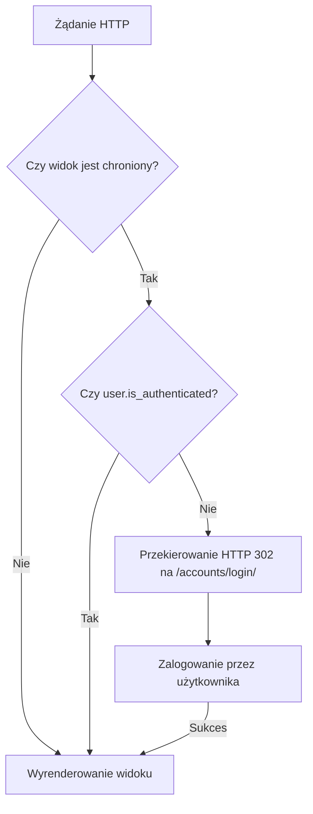

## 1. Wbudowany system autentykacji (django.contrib.auth)

Django posiada wbudowany, wysoce bezpieczny system zarządzania użytkownikami, logowania i autentykacji. Aby z niego skorzystać, nie trzeba pisać własnej logiki sprawdzania haseł, wystarczy podpiąć odpowiednie widoki systemowe do głównego pliku konfiguracyjnego adresów URL.

### Krok 1: Podpięcie ścieżek URL

W głównym pliku projektu należy zaimportować wbudowane ścieżki (tzw. `auth.urls`).

```python
# projekt/urls.py
from django.urls import include, path

urlpatterns = [
    # Wbudowane widoki autentykacji (login, logout, password_change itp.)
    path('accounts/', include('django.contrib.auth.urls')),
    # ... inne ścieżki ...
]
```

Dzięki temu jednemu wpisowi aplikacja zyskuje automatyczną obsługę endpointów takich jak `/accounts/login/` czy `/accounts/logout/`.

### Krok 2: Konfiguracja przekierowań

Framework musi wiedzieć, dokąd przekierować użytkownika po pomyślnym zalogowaniu lub wylogowaniu. Odpowiednie stałe należy zdefiniować na końcu głównego pliku konfiguracyjnego.


```python
# projekt/settings.py

# Gdzie przekierować po udanym logowaniu (np. strona główna lub panel)
LOGIN_REDIRECT_URL = '/'

# Gdzie przekierować po wylogowaniu
LOGOUT_REDIRECT_URL = '/'
```

## 2. Logowanie i Wylogowywanie (Szablony)

Widoki wbudowane w Django zawierają kompletną logikę, ale domyślnie nie dostarczają gotowych plików HTML. Należy je utworzyć we wskazanej przez framework strukturze katalogów.

### Szablon Logowania

Domyślnie widok logowania poszukuje szablonu w ścieżce `registration/login.html`.

```html
<h2>Zaloguj się</h2>


  <p class="error">Nazwa użytkownika lub hasło są niepoprawne.</p>


<form method="post" action="">
    
    
    {{ form.as_p }}
    
    <button type="submit">Zaloguj</button>
</form>
```

Zastosowanie tagu `` jest obligatoryjne dla każdego formularza modyfikującego stan i przesyłanego metodą POST. (Szczegóły w notatce Y-901).

> [!warning] **Brakujące szablony dla pozostałych widoków auth**
>
> `include('django.contrib.auth.urls')` podpina nie tylko `login`/`logout`, ale też widoki resetowania i zmiany hasła: `password_change`, `password_change_done`, `password_reset`, `password_reset_done`, `password_reset_confirm`, `password_reset_complete`. Każdy z nich domyślnie szuka własnego szablonu w katalogu `registration/` (np. `registration/password_reset_form.html`). Dopóki nie utworzysz tych plików, wejście na dany adres zakończy się błędem `TemplateDoesNotExist` – samo `login.html` nie wystarczy.

### Rozpoznawanie stanu użytkownika w szablonach

Obiekt `user` jest automatycznie wstrzykiwany do kontekstu każdego szablonu. Można wykorzystać go do warunkowego wyświetlania treści. Wylogowanie realizuje się zazwyczaj za pomocą formularza przesyłanego metodą POST, co stanowi standard bezpieczeństwa we współczesnych aplikacjach.

```html
<div>
    
        <p>Zalogowany jako: {{ user.username }}</p>
        <form method="post" action="">
            
            <button type="submit">Wyloguj</button>
        </form>
    
        <p>Witaj, gościu!</p>
        <a href="">Zaloguj się</a>
    
</div>
```

## 3. Rejestracja Użytkowników

W przeciwieństwie do logowania, Django nie dostarcza wbudowanego widoku (endpointu) rejestracji, ponieważ proces ten często zależy od specyficznych wymagań biznesowych. Framework dostarcza jednak gotowy formularz `UserCreationForm`, który automatycznie waliduje dane i bezpiecznie hashuje hasła przed zapisem do bazy.

Do wdrożenia rejestracji zaleca się wykorzystanie widoków generycznych z modułu `django.views.generic`.
### Implementacja widoku rejestracji

```python
# aplikacja/views.py
from django.urls import reverse_lazy
from django.views import generic
from django.contrib.auth.forms import UserCreationForm

class SignUpView(generic.CreateView):
    # Wskazanie wbudowanego formularza
    form_class = UserCreationForm
    # reverse_lazy opóźnia wywołanie urla, dopóki plik urls.py nie zostanie w pełni załadowany
    success_url = reverse_lazy('login')
    # Wskazanie własnego szablonu
    template_name = 'registration/signup.html'
```

Należy następnie podpiąć ten widok w pliku `urls.py` (np. `path('signup/', views.SignUpView.as_view(), name='signup')`) i stworzyć plik HTML z formularzem pod ścieżką wskazaną w `template_name`.

### Szablon rejestracji (`registration/signup.html`)

`UserCreationForm` to zwykły Django `Form` (a właściwie `ModelForm`), więc renderuje się dokładnie tak samo jak formularz logowania – przez `{{ form.as_p }}`. Nie trzeba ręcznie wypisywać pól `username`/`password1`/`password2`.

```html
<h2>Zarejestruj się</h2>

<form method="post">
    

    {{ form.as_p }}

    <button type="submit">Utwórz konto</button>
</form>
```

> [!important] **Dlaczego `template_name` trzeba podać jawnie?**
>
> `LoginView` to specyficzny, gotowy widok wbudowany w Django – ma na sztywno zaszyty domyślny szablon `registration/login.html`, więc działa "od ręki" bez ustawiania `template_name`.
>
> `SignUpView` u nas dziedziczy po generycznym `CreateView`, który **nie zna** żadnej konwencji `registration/*`. Jego domyślna reguła nazewnictwa szablonu to `<app_label>/<nazwa_modelu>_form.html` – a ponieważ `UserCreationForm` operuje na modelu `User` z aplikacji `auth`, bez jawnego `template_name` Django szukałoby `auth/user_form.html`, czyli ścieżki zupełnie nieintuicyjnej i niepasującej do reszty szablonów logowania.
>
> Dlatego w `SignUpView` **musisz** samodzielnie ustawić `template_name = 'registration/signup.html'` (nazwa pliku – `signup.html` czy `register.html` – jest tu Twoim wyborem, byle zgadzała się z tym, co wpiszesz w `template_name`).

## 4. Zabezpieczanie Widoków (Restrykcje dostępu)

Często zachodzi potrzeba ograniczenia dostępu do wybranych podstron wyłącznie dla zalogowanych użytkowników. Podejście różni się w zależności od rodzaju zastosowanego widoku.

> [!warning] **Przekierowanie po pomyślnym logowaniu (Parametr `next`)**
> 
> Jeśli niezalogowany użytkownik spróbuje wejść na chronioną stronę, Django zablokuje dostęp i przekieruje go na stronę logowania, doklejając parametr `?next=/chroniona-strona/`. Po poprawnym zalogowaniu system odczyta ten parametr i odeśle użytkownika tam, gdzie pierwotnie próbował wejść.

### A. Widoki Funkcyjne (FBV)

Dla klasycznych funkcji wykorzystuje się dekorator `@login_required`.
```python
# aplikacja/views.py
from django.contrib.auth.decorators import login_required
from django.shortcuts import render

@login_required
def chroniony_widok(request):
    return render(request, 'tajny_szablon.html')
```

### B. Widoki Generyczne (CBV)

W klasach (np. `ListView`, `DetailView`) stosuje się tzw. domieszkę (mixin) o nazwie `LoginRequiredMixin`.

> [!important] **Kolejność dziedziczenia**
> 
> Zgodnie ze sposobem rozwiązywania metod w Pythonie (MRO), `LoginRequiredMixin` **musi** znajdować się jako pierwszy argument na liście klas bazowych (po lewej stronie).


```python
# aplikacja/views.py
from django.contrib.auth.mixins import LoginRequiredMixin
from django.views import generic

class ChronionyWidok(LoginRequiredMixin, generic.TemplateView):
    template_name = 'tajny_szablon.html'
```

## 5. Architektura Przepływu Autentykacji

Poniższy diagram obrazuje uproszczony cykl decyzyjny przy żądaniu dostępu do zabezpieczonego widoku:

